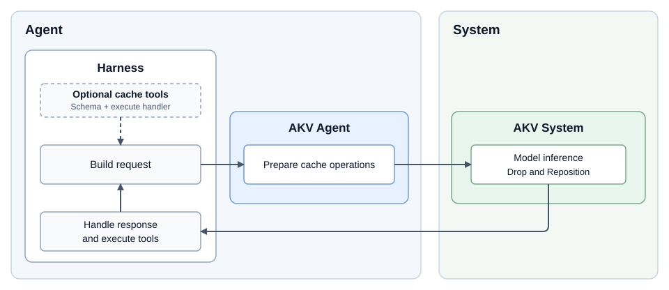

<div align="center">
  
  <h1>AKV</h1>
  <h3>Cache Engineering for Agents</h3>

  <p>
    <a href="https://fuvty.github.io/thinking_yard_project_page/projects/akv/">🌐 <b>Project Page</b></a>
  </p>
</div>

AKV brings KV cache engineering to LLM agents. It combines agent-side policies for deciding what to drop and when to compact positions with an SGLang-based inference system that executes those operations while reusing compatible KV cache.

- `akv.agent` is the algorithm component that decides which messages to drop from the KV cache and when to reposition retained tokens.
- `akv.system` executes cache operations through SGLang's OpenAI-compatible Chat Completions API.


## Environment Setup

### 1. Install Rust and Cargo if they are not already available

```bash
curl -o install-rust.sh https://sh.rustup.rs
sh install-rust.sh -y
source "$HOME/.cargo/env"
```

### 2. Create the `akv` environment and install the agent and system together

```bash
git clone https://github.com/thu-nics/AKV.git
cd AKV
uv venv --python 3.12
source .venv/bin/activate
uv pip install -e .
```

The environment is stored in `.venv` to avoid conflicting with the `akv/` source directory. See the [system README](akv/system/README.md) and the [agent README](akv/agent/README.md) for dependencies.

## Quick Start

These examples use GPT-OSS-120B, served as `gpt-oss-120b`.

### 1. Launch the system

```bash
python -m akv.system.launch_server \
  --model-path /path/to/gpt-oss-120b \
  --reasoning-parser gpt-oss \
  --tool-call-parser gpt-oss \
  --tp-size 2 \
  --port 8000
```

For additional launch options, see the [system README](akv/system/README.md).

### 2. Apply an AKV CachePolicy

AKV uses `CachePolicy` to determine cache operations based on the current request and execution history. Given an OpenAI-compatible request payload, `CachePolicy` augments it with cache operation fields as needed: `drop_message` specifies which messages' KV entries to drop and when to apply Drop, while `reposition` specifies when to apply Reposition to compact the retained token positions.

The following example applies a policy that retains the KV entries of the latest tool batch and schedules Reposition. The request contains two completed tool calls, with results at message indices 2 and 4.

```python
from akv.agent import CachePolicy
from akv.agent.policies import BatchTrigger, KeepBatches, BatchReposition

payload = {
    "model": "gpt-oss-120b",
    "messages": [
        {
            "role": "user", 
            "content": "Compare records A and B."
        },
        {
            "role": "assistant", 
            "tool_calls": [{
                "id": "a", "type": "function",
                "function": {"name": "read_record", "arguments": '{"record_id":"A"}'},
            }],
        },
        {
            "role": "tool", 
            "tool_call_id": "a", 
            "content": "Record A"
        },
        {
            "role": "assistant", 
            "tool_calls": [{
                "id": "b", "type": "function",
                "function": {"name": "read_record", "arguments": '{"record_id":"B"}'},
            }],
        },
        {
            "role": "tool", 
            "tool_call_id": "b", 
            "content": "Record B"
        },
    ],
    "stream": True,
    "max_completion_tokens": 2048,
}

policy = CachePolicy(
    trigger=BatchTrigger(),
    selector=KeepBatches(1),
    reposition=BatchReposition(after=2, every=2),
)
akv_payload, state = policy.process(payload, api_style="sglang")
```

Here, `akv_payload` preserves the entire original payload and adds:

```json
{
  "drop_message": {"4": [2]},
  "reposition": [4]
}
```
`drop_message` specifies which messages' KV entries to remove and after which message to apply the deletion. `reposition` specifies when to compact the retained token positions.

<details>
<summary>View the complete akv_payload</summary>

```python
akv_payload = {
    "model": "gpt-oss-120b",
    "messages": [
        {
            "role": "user",
            "content": "Compare records A and B."
        },
        {
            "role": "assistant",
            "tool_calls": [{
                "id": "a", "type": "function",
                "function": {"name": "read_record", "arguments": '{"record_id":"A"}'},
            }],
        },
        {
            "role": "tool",
            "tool_call_id": "a",
            "content": "Record A"
        },
        {
            "role": "assistant",
            "tool_calls": [{
                "id": "b", "type": "function",
                "function": {"name": "read_record", "arguments": '{"record_id":"B"}'},
            }],
        },
        {
            "role": "tool",
            "tool_call_id": "b",
            "content": "Record B"
        },
    ],
    "drop_message": {"4": [2]},
    "reposition": [4],
    "stream": True,
    "max_completion_tokens": 2048,
}
```

</details>

### 3. Send request to system

After applying the policy, you can send `akv_payload` directly to the system as the request body. 

```python
import requests

response = requests.post(
    "http://localhost:8000/v1/chat/completions",
    json=akv_payload,
    timeout=120,
)
response.raise_for_status()
```

After processing message 4, AKV System removes message 2's KV entries, compacts the retained token positions, and generates the next reply using the remaining context.

<details>
<summary>Explanation to the request</summary>

We number the indices of messages (which is from 0), including system, user, assistant, and tool messages.
In the example above:

| Index | Role | Content |
| --- | --- | --- |
| 0 | user | Compare records A and B. |
| 1 | assistant | "tool_calls": `read_record(A)` |
| 2 | tool | Record A |
| 3 | assistant | "tool_calls": `read_record(B)` |
| 4 | tool | Record B |

| Field | Format | Example | Meaning |
| --- | --- | --- | --- |
| `messages` | OpenAI-Compatible messages | The four messages above | The full conversation history, including messages selected for dropping. |
| `drop_message` | `{"<trigger_message_index>" : [<message_to_drop_index>, ...]}` | `{"4": [2]}` | After processing message 4, drop the KV cache of messages 2  from the active context. |
| `reposition` | `[<trigger_message_index>, ...]` | `[4]` | After processing message 4, compact the remaining token positions to remove gaps. |

We can read the example as: **process message 4 $\to$ drop messages 2 $\to$ compact token positions $\to$ generate the reply.**

Hints:

- Do not remove messages 2 from the request yourself.
- `drop_message` and `reposition` are optional and independent. If at one message, both two operations are triggered, the system always drop the message **first**, then reposition.
- Repositioning does not change message indices. Keep the full history and its original numbering; the server applies the operations.

</details>


### Run a tool-calling Agent example

The [demo code](examples/demo.py) works as an agent, asking the model to find a parcel’s final delivery location. 

During execution, the model can call `drop_context` to drop `tool_call` that are no longer need. Before the next model request, AKV‘s `CachePolicy` converts successful drop requests into `drop_message` fields. Reposition is scheduled after every three completed tool-call batches.

Run the demo with:

```bash
python examples/demo.py \
  --base-url http://localhost:8000/v1 \
  --model gpt-oss-120b \
  --output local/demo-tool-01
```

As the demo runs, you can watch the model follow the chain of delivery records, manage its context by discarding results it no longer needs, and ultimately identify the parcel's final delivery location.

## Integrate with an agent harness

Integrating AKV requires only one step: **process the final payload before sending request to the system**. After the harness serializes its history and tools, pass the payload to [CachePolicy.process](akv/agent/policy.py), then send the returned payload to AKV System.

**Optional: register cache tools.** If your policy uses a [CacheTool](akv/agent/policies/tools.py), register its schema and `execute` handler with the harness before starting the agent loop.



## Details

### Agent: Cache Engineering with CachePolicy

`CachePolicy` manages the KV cache throughout agent execution by scheduling Drop and Reposition. **Drop removes selected messages' KV entries without changing the retained token positions, while Reposition compacts those positions.** Retained KV entries are reused without re-prefilling after both operations.

<details>
<summary>Example of CachePolicy works in Multi-Turn Execution</summary>

For example, the following policy retains the KV entries of the latest two tool batches and schedules Reposition every two batches starting from the fourth:

```python
policy = CachePolicy(
    trigger=BatchTrigger(),
    selector=KeepBatches(2),
    reposition=BatchReposition(after=4, every=2),
)
```

Assuming each tool batch occupies one token block, the cache evolves as follows:

| Batch | Tool history | New Drop | Reposition | Retained KV (positions) |
|---|---|---|---|---|
| 1 | A | — | No | A(0) |
| 2 | A, B | — | No | A(0), B(1) |
| 3 | A, B, C | A | No | B(1), C(2) |
| 4 | A, B, C, D | B | Yes | C(0), D(1) |
| 5 | A, B, C, D, E | C | No | D(1), E(2) |
| 6 | A, B, C, D, E, F | D | Yes | E(0), F(1) |

Here, positions are illustrative block indices rather than actual token positions. `Tool history` shows the unchanged, cumulative tool history; `New Drop` lists only the tool results whose KV entries are newly dropped at each step.
</details>

#### Customizing `CachePolicy`

`CachePolicy` combines three independently configurable components. Each receives a `PolicyContext` containing the current request and earlier cache operations.

| Component | Return value | When it runs | Built-in choices |
| --- | --- | --- | --- |
| `trigger` | `bool`: `True` to run the selector. | When the policy evaluates new history. | [BatchTrigger, TokenTrigger, ToolTrigger](akv/agent/policies/triggers.py) |
| `selector` | `set[int]`: canonical IDs of messages whose KV entries to drop. | Only when the trigger returns `True`. | [KeepBatches, KeepTokens, ToolSelection](akv/agent/policies/selectors.py) |
| `reposition` | `bool`: `True` to schedule Reposition. | On new history, independently of the trigger. | [BatchReposition, TokenReposition, ToolReposition](akv/agent/policies/reposition.py) |


The built-in components support three approaches:

- **Batch-based:** schedule Drop and Reposition by completed tool batches and retain the latest batches. A batch includes all results from one assistant tool-calling message.
- **Token-based:** use token thresholds to trigger Drop or Reposition, and token budgets to select old results for removal. These components require a token counter matching the model.
- **Tool-based:** let the model select messages for Drop through a registered cache tool. The policy reads successful tool results to schedule Drop and, optionally, Reposition.

To customize a policy, supply your own `trigger`, `selector`, or `reposition` function to `CachePolicy`. 

For example, this policy checks after each completed batch, selects all but the latest visible tool result for Drop, and schedules Reposition whenever the selection is nonempty:

```python
from akv.agent import CachePolicy, PolicyContext


def after_tool_batch(context: PolicyContext) -> bool:
    return context.new_batch


def select_old_results(context: PolicyContext) -> set[int]:
    visible_results = [
        i for i, message in enumerate(context.request.messages)
        if message["role"] == "tool" and i not in context.hidden
    ]
    return set(visible_results[:-1])  # Keep the latest result.


def reposition_after_drop(context: PolicyContext, selected: set[int]) -> bool:
    return bool(selected)


policy = CachePolicy(
    trigger=after_tool_batch,
    selector=select_old_results,
    reposition=reposition_after_drop,
)
```

With the Quick Start payload, this policy selects message 2 for Drop, retains message 4's KV entries, and schedules Reposition. It adds `drop_message={"4": [2]}` and `reposition=[4]` to the request.

### System: Drop and Reposition

AKV extends standard chat interface with three optional request fields to realize drop and reposition in serving system. An AKV policy can generate these fields, or you can write them directly, alongside `message` with `JSON` body.

| Field | How to write it | Meaning |
| --- | --- | --- |
| `drop_message` | `Dict: {"3": [1, 2]}` | After processing message 3, drop the KV cache of messages 1 and 2. The key specifies where; the list specifies what to drop. |
| `drop_rule` | `Dict: {"type": "message_drop", "drop_messages": {"3": [1, 2]}}` | Equivalent to the `drop_message` example above. **Use either form, not both.** |
| `drop_rule` | `Dict: {"type": "thinking_drop"}` | Drop each historical assistant message’s reasoning KV after processing that message, while keeping its final answer. Do not use it with `drop_message` or non-thinking mode. |
| `reposition` | `List: [3]` | After processing message 3, compact the remaining token positions to remove gaps. If Drop is also scheduled there, Drop runs first. |

For complete requests, see:
- [Message Drop](examples/message_drop.py): two equivalent ways to specify which messages to drop, combined with Reposition.
- [Thinking Drop](examples/thinking_drop.py): remove historical reasoning while retaining final answers, combined with Reposition.

Context requests report `cached_tokens`, `drop_skipped_tokens`, and `repos_tokens` in `usage.prompt_tokens_details`, including zero values. See the [system README](akv/system/README.md) for rule details and usage accounting.

## Supported Models

Drop/Reposition is currently enabled for these text-model architectures:


| Model family                                  | Architecture |
| --- | --- |
| Qwen | `QWenLMHeadModel` |
| Qwen1.5, Qwen2, Qwen2.5 | `Qwen2ForCausalLM`, `Qwen2MoeForCausalLM` |
| Qwen3, including MoE variants and AgenticQwen | `Qwen3ForCausalLM`, `Qwen3MoeForCausalLM` |
| GPT-OSS | `GptOssForCausalLM` |
| MiniMax-M2 family, including M2.7 | `MiniMaxM2ForCausalLM` |


See the [system README](akv/system/README.md) for runtime requirements and compatibility details.
